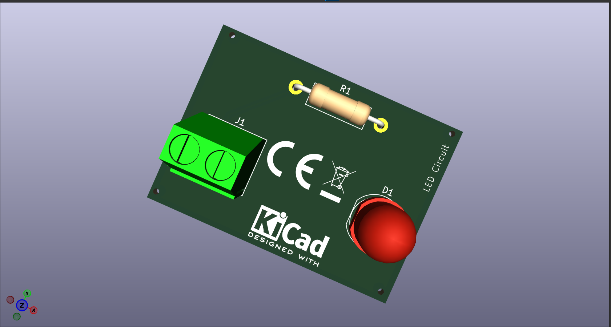

# LED Circuit PCB Design Using KiCad

## Project Overview
This project demonstrates the design of a simple LED circuit PCB using KiCad. It includes circuit schematic design, PCB layout, component placement, and 3D visualization.

## Objective
To design a simple and compact PCB for an LED circuit using electronic components and PCB design software.

## Software Used
- KiCad 10.0

## Components Used
- LED (D1)
- Resistor (R1)
- 2-pin Screw Terminal (J1)

## Design Features
- Circuit schematic design
- PCB layout design
- Component placement
- 3D PCB visualization

## 3D PCB View

## Project Files
- `My_First_PCB.kicad_pro` – KiCad project file
- `My_First_PCB.kicad_sch` – Circuit schematic
- `My_First_PCB.kicad_pcb` – PCB layout

## Tools and Technologies
KiCad | PCB Design | Electronic Circuit Design

## Author
Aishwarya H

